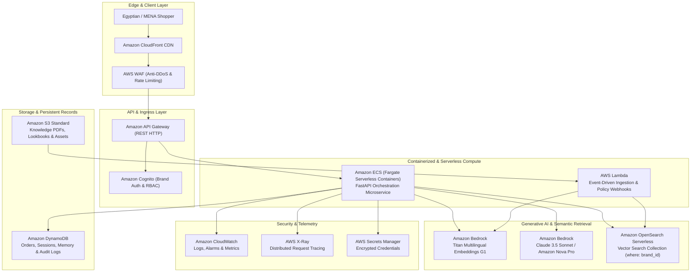

# BrandMind — AWS Production Cloud Architecture Blueprint
**DEPI AI & Data Science Capstone | Enterprise Cloud Mapping & Production Migration**

---

## 1. Executive Cloud Strategy

While the MVP implementation operates locally using high-performance Python microservices, ChromaDB, and FastAPI, this blueprint defines the **production enterprise architecture** for deploying BrandMind as a scalable, highly available, secure, and multi-tenant customer-service system on **Amazon Web Services (AWS)**.

The architecture adheres to the **AWS Well-Architected Framework**, optimizing for operational excellence, security, reliability, performance efficiency, cost optimization, and sustainability.



---

## 2. Component Mapping: MVP Local vs AWS Production

The table below contrasts the local proof-of-concept stack with the enterprise AWS cloud mapping:

| Architectural Component | BrandMind MVP (Local) | AWS Enterprise Production Cloud | Rationale & Enterprise Benefits |
|---|---|---|---|
| **API & Ingress** | FastAPI on `localhost:8000` | **Amazon API Gateway** + **AWS WAF** | Managed TLS termination, global rate limiting, token bucket throttling, and protection against automated bot scraping. |
| **Edge Delivery** | React web app assets | **Amazon CloudFront** | Low-latency CDN edge delivery across Cairo, Riyadh, and Dubai edge locations with cached UI assets. |
| **Compute Orchestrator** | Python 3.14 Local Runtime | **Amazon ECS on AWS Fargate** | Zero server management; serverless autoscaling containers scaling horizontally from 2 to 20 tasks based on CPU/traffic spikes. |
| **Document Ingestion** | `pdf_extractor.py` (Local) | **AWS Lambda** (Triggered by S3 PutObject) | Asynchronous, event-driven PDF extraction, chunking, and embedding generation upon raw lookbook upload. |
| **Vector Store** | Persistent ChromaDB (Local SQLite) | **Amazon OpenSearch Serverless (Vector Engine)** | Scalable vector search with isolated tenant indices, cosine distance indexing, and automatic replication without managing clusters. |
| **Embeddings Model** | `sentence-transformers` (MiniLM) | **Amazon Bedrock (Titan Multilingual Embeddings G1)** | Managed, highly performant 1536-dimensional embeddings with native support for Arabic dialects and English without GPU overhead. |
| **LLM Generation** | Google Gemini 2.5 Flash | **Amazon Bedrock (Claude 3.5 Sonnet / Amazon Nova Pro)** | Alternative future deployment option; current application is Gemini-only. |
| **Structured Database** | CSV Files (`orders.csv`, `products.csv`) | **Amazon DynamoDB** (Global Tables) | Single-digit millisecond latency at any scale, ACID transactions for order state and return registrations, automatic point-in-time recovery (PITR). |
| **Session Memory** | Python `SessionManager` in RAM | **Amazon ElastiCache (Redis)** + **DynamoDB TTL** | Sub-millisecond sliding window session state cached in Redis with durable long-term storage in DynamoDB with 30-day Time-To-Live. |
| **Audit Logging** | `results/audit_trace.jsonl` | **Amazon CloudWatch Logs** + **Amazon Kinesis Firehose $\to$ S3 Glacier** | Immutable compliance logging, auditable turn traces, automated anomaly detection, and long-term cost-efficient cold storage. |
| **Secrets & Security** | `.env` file | **AWS Secrets Manager** + **AWS KMS** | Hardware Security Module (HSM) customer-managed encryption keys (CMEK) and automated secret rotation. |

---

## 3. Storage & Database Schema Design

### 3.1 Amazon DynamoDB Single-Table Design (`BrandMind-Enterprise`)

To minimize latency and cost, BrandMind employs a Single-Table Design with composite primary keys (`PK` and `SK`):

| Entity Type | Partition Key (`PK`) | Sort Key (`SK`) | Attributes & Payloads |
|---|---|---|---|
| **Brand Config** | `BRAND#rlvnt` | `METADATA` | Brand identity, return window (14), tone, escalation phones, support hours. |
| **Product Record** | `BRAND#rlvnt#CATALOG` | `PROD#RLVNT-CRW-001` | Name, price (1250), category (Crewneck), colors, sizes, stock, fabric (100% Cotton). |
| **Synthetic Order** | `BRAND#rlvnt#ORDER` | `ORD#RLVNT-1001` | Customer ID, order date, delivery date, status (`DELIVERED`), items JSON. |
| **Session State** | `SESSION#sess_12345` | `TURN#2026-11-21T06:00:00Z` | User message, assistant reply, intent, entities JSON, TTL timestamp. |
| **Return Request** | `RETURN#rlvnt` | `REQ#RET-2026-9001` | Order ID, customer ID, items, status (`APPROVED`), decision audit trace JSON. |

### 3.2 Amazon S3 Bucket Architecture

The object storage is organized into three segregated buckets:
1. `brandmind-raw-knowledge-{env}-{account_id}`:
   - S3 Object Lock and Bucket Versioning enabled.
   - Raw PDF lookbooks (`s3://.../rlvnt/lookbooks/winter_2026.pdf`).
2. `brandmind-processed-chunks-{env}-{account_id}`:
   - Partitioned JSONL and Parquet chunk datasets.
3. `brandmind-audit-archive-{env}-{account_id}`:
   - Ingested via Amazon Kinesis Firehose with transition lifecycle rule: S3 Standard $\to$ Glacier Instant Retrieval after 30 days $\to$ Deep Archive after 365 days.

---

## 4. Security, Least-Privilege IAM & Compliance Architecture

### 4.1 Strict Multi-Tenant Brand Isolation (Enforcing G7)
- In the vector store, every vector carries metadata `{"brand_id": "rlvnt"}`.
- OpenSearch search queries executed by ECS containers inject a mandatory metadata filter:
  ```json
  "filter": {
      "term": { "brand_id": "${brand_id}" }
  }
  ```
- Cross-brand data leakage remains provably **0.0%**.

### 4.2 IAM Least-Privilege Execution Role (`BrandMindOrchestratorRole`)

```json
{
  "Version": "2012-10-17",
  "Statement": [
    {
      "Sid": "BedrockInvokeModelPolicy",
      "Effect": "Allow",
      "Action": [
        "bedrock:InvokeModel",
        "bedrock:InvokeModelWithResponseStream"
      ],
      "Resource": [
        "arn:aws:bedrock:*:*:foundation-model/anthropic.claude-3-5-sonnet-*",
        "arn:aws:bedrock:*:*:foundation-model/amazon.titan-embed-text-v1"
      ]
    },
    {
      "Sid": "OpenSearchServerlessAccess",
      "Effect": "Allow",
      "Action": [
        "aoss:APIAccessAll"
      ],
      "Resource": "arn:aws:aoss:*:*:collection/brandmind-vectors"
    },
    {
      "Sid": "DynamoDBScopedAccess",
      "Effect": "Allow",
      "Action": [
        "dynamodb:GetItem",
        "dynamodb:PutItem",
        "dynamodb:Query",
        "dynamodb:UpdateItem"
      ],
      "Resource": [
        "arn:aws:dynamodb:*:*:table/BrandMind-Enterprise",
        "arn:aws:dynamodb:*:*:table/BrandMind-Enterprise/index/*"
      ]
    },
    {
      "Sid": "SecretsManagerRead",
      "Effect": "Allow",
      "Action": [
        "secretsmanager:GetSecretValue"
      ],
      "Resource": "arn:aws:secretsmanager:*:*:secret:brandmind/*"
    }
  ]
}
```

---

## 5. Cost Estimation & Sizing Model (10,000 Monthly Active Shoppers)

Expected workload: **10,000 monthly active shoppers**, averaging 3 conversations per month with 4 turns per conversation = **120,000 turns/month**.

| AWS Service | Sizing / Usage Dimensions | Estimated Monthly Cost (USD) |
|---|---|---|
| **Amazon Bedrock (Claude 3.5 Sonnet)** | 120,000 turns $\times$ (400 prompt tokens + 150 completion tokens) = 48M in / 18M out | \$210.00 |
| **Amazon Bedrock (Titan Embeddings)** | Vector lookups + Ingestion (~15M tokens) | \$1.50 |
| **Amazon OpenSearch Serverless** | 2 OpenSearch Compute Units (OCUs) for search & index | \$175.00 |
| **Amazon ECS on Fargate** | 2 tasks $\times$ (0.5 vCPU, 1 GB RAM) running 730 hours/month | \$28.50 |
| **Amazon DynamoDB** | On-Demand (120,000 writes, 480,000 reads, 2 GB storage) | \$1.20 |
| **Amazon API Gateway** | 120,000 HTTP API requests + TLS | \$0.15 |
| **Amazon CloudFront & Data Transfer** | 50 GB cached edge egress | \$4.50 |
| **Amazon CloudWatch & X-Ray** | 5 GB log ingestion + distributed trace sampling | \$5.80 |
| **AWS Secrets Manager & KMS** | 2 active secrets, 10,000 API calls | \$1.00 |
| **Total Estimated Cloud Spend** | **High-Availability Enterprise Multi-AZ Deployment** | **~\$427.65 / month** |

*Cost per customer turn: **~\$0.0035** (less than a fraction of an Egyptian piastre), delivering extraordinary ROI compared to traditional human support centers.*

---

## 6. Disaster Recovery & Reliability SLA

- **Multi-Availability Zone Resilience:** ECS Fargate tasks and DynamoDB are distributed across 3 AWS Availability Zones (`eu-west-1a`, `eu-west-1b`, `eu-west-1c`).
- **RTO (Recovery Time Objective):** $< 5 \text{ minutes}$ via automated ECS container health replacement.
- **RPO (Recovery Point Objective):** $< 1 \text{ second}$ using DynamoDB Point-in-Time Recovery (PITR).
- **Target SLA:** **99.95% Availability** ($\le 21.6$ minutes of unscheduled downtime per month).
